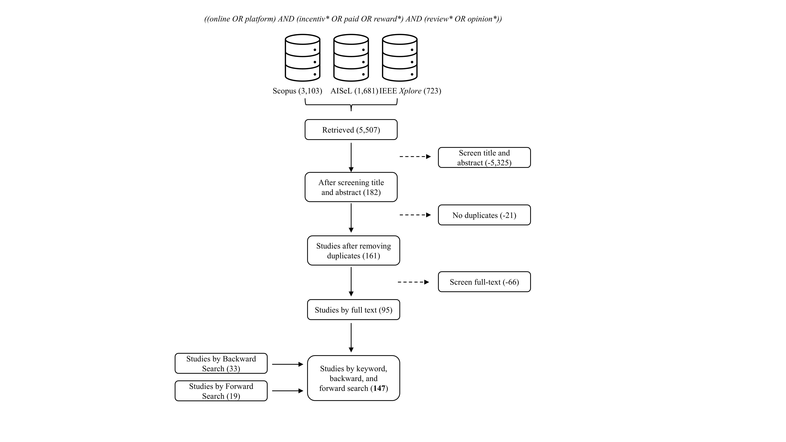

# Supplemental Material for *Incentivizing Online Reviews: A Framework and Systematic Literature Review of Strategies and Effects*

This repository contains the supplemental materials accompanying the manuscript *Incentivizing Online Reviews: A Framework and Systematic Literature Review*. The repository provides the complete study sample, coding scheme, coding results for psychological and behavioral outcome, and publication outlet information.

## Literature Search Process

The systematic literature search and study selection process is illustrated below. The final set of included studies corresponds to the dataset provided in [`systematic_review_complete_sample.csv`](./systematic_review_complete_sample.csv).



*Figure 1. Study selection process.*

## Literature Screening Records

To enhance the transparency and reproducibility of our systematic literature review, we provide the records retained after title and abstract screening of the database search results.

The file **[stored_literature_keyword_search.csv](stored_literature_keyword_search.csv)** contains bibliographic information and screening decisions for 182 records retrieved from Scopus (n = 139), AISeL (n = 23), and IEEE Xplore (n = 20).

The dataset documents the subsequent screening process:

- **21 duplicate records** identified across databases (duplicate Tag).
- **66 publications excluded** during full-text screening (Not important Tag).
- **95 publications included** in the final sample through the keyword search (Relevant Tag).

For each record, the file provides bibliographic information, source database, publication link, and screening classification.


## Backward and Forward Search Records

To complement the keyword search, backward and forward searches were conducted to identify additional relevant publications. The corresponding records are documented in two separate files:

- **[stored_literature_backward_search](stored_literature_backward_search.csv)**: Contains the 29 additional publications identified through backward searching.
- **[stored_literature_forward_search](stored_literature_forward_search.csv)**: Contains the 22 additional publications identified through forward searching.

Both files provide bibliographic information, including publication year, authors, title, outlet, and URL, as well as the following fields:

- **`Record ID`**: A unique identifier assigned to each publication, enabling cross-referencing between the keyword, backward, and forward search files.
- **`Date Added`**: The date on which the publication was added to the Zotero reference management library. In most cases, this corresponds to the date of identification during the literature search. However, some publications had already been stored in Zotero before the systematic search and therefore have earlier dates.
- **`Seed Publication ID`**: Refers to the Record ID of the publication used as the starting point for identifying an additional publication through backward or forward searching. In backward searching, the seed publication's reference list was examined, leading to the identification of the corresponding publication. In forward searching, publications citing the seed publication were examined, leading to the identification of the corresponding publication. The IDs link records across the keyword, backward, and forward search files, allowing the search pathways to be traced.

Together with the keyword search records, these files document the identification and selection of the 147 publications included in the final sample.


## Final Sample
### [`systematic_review_complete_sample.csv`](./systematic_review_complete_sample.csv)

Contains the complete sample of publications (N=147) included in the systematic literature review. For each publication, the dataset reports the search strategy through which the study was identified, bibliographic information (title, authors, publication year), study characteristics (empirical/theoretical), as well as the investigated incentives.

---
## Literature Coding Process

### [`coding_scheme.csv`](./coding_scheme.csv)

Contains the complete coding scheme applied during the systematic literature review. The file documents the coding categories, constructs, and operational definitions that guided the coding process.

This coding scheme served as the basis for coding the investigated outcomes in every study contained in [`systematic_review_complete_sample.csv`](./systematic_review_complete_sample.csv).

---

### [`coding_psychological_outcome.csv`](./coding_psychological_outcome.csv)

Contains the coding for psychological outcomes identified in the reviewed literature. The effect-direction codes indicate how an incentive or incentivizing strategy is associated with the respective psychological outcome.
| Effect Direction | Description |
|------------------|-------------|
| **+** | The incentivizing strategy or incentive has a positive effect on the psychological outcome (i.e., increases or strengthens the outcome). |
| **−** | The incentivizing strategy or incentive has a negative effect on the psychological outcome (i.e., decreases or weakens the outcome). |
| **+/−** | The study reports both positive and negative effects, for example, depending on the incentive types. |
| **o** | No statistically significant effect on the psychological outcome is reported. |
| **NA** | Not applicable; no relationship is examined or reported. |

---

### [`psychological_outcome_categories.csv`](./psychological_outcome_categories.csv)

Psychological outcomes were grouped according to their dominant psychological function. The file groups individual psychological outcome constructs into seven broader conceptual categories (e.g., cognitive and belief-based responses, affective responses, normative and moral evaluations, and personal motivational processes) and provides a definition for each category.

---
### [`coding_behavioral_outcome.csv`](./coding_behavioral_outcome.csv)

Contains the coding for behavioral outcomes identified in the reviewed literature. The effect-direction codes indicate how an incentive or incentivizing strategy is associated with the respective behavioral outcome.
| Effect Direction | Description |
|------------------|-------------|
| **+** | The incentivizing strategy or incentive has a positive effect on the behavioral outcome (i.e., increases or strengthens the outcome). |
| **−** | The incentivizing strategy or incentive has a negative effect on the behavioral outcome (i.e., decreases or weakens the outcome). |
| **+/−** | The study reports both positive and negative effects, for example, depending on the incentive types. |
| **o** | No statistically significant effect on the behavioral outcome is reported. |
| **NA** | Not applicable; no relationship is examined or reported. |
---
## Literature Outlet

### [`outlets_journals.csv`](./outlets_journals.csv)

Contains all journals represented in the final study sample. For each journal, the file reports:

- **SJR (SCImago Journal Rank) quartile**
- **VHB-JOURQUAL 3 ranking**
- **ABS Academic Journal Guide ranking**
- **Frequency**, indicating the number of studies published in the respective journal that were included in the systematic literature review.

#### Journal Ranking Summary

**SJR Ranking**

| Ranking | Frequency |
|---------|----------:|
| Q1 | 98 |
| Q2 | 9 |
| Q3 | 4 |
| Q4 | 1 |
| Not listed | 1 |

**VHB-JOURQUAL 3**

| Ranking | Frequency |
|---------|----------:|
| A+ | 14 |
| A | 3 |
| B | 24 |
| C | 4 |
| Not listed | 69 |

**ABS Academic Journal Guide**

| Ranking | Frequency |
|---------|----------:|
| 1 | 17 |
| 2 | 21 |
| 3 | 30 |
| 4 | 9 |
| 4* | 20 |
| Not listed | 16 |

---

### [`outlets_conferences.csv`](./outlets_conferences.csv)

Contains all conferences represented in the final study sample. For each conference, the file reports:

- **VHB conference ranking** (where available)
- **Frequency**, indicating the number of studies published in the respective conference proceedings that were included in the systematic literature review.

Conferences that are not covered by the VHB ranking are reported as **Not listed**.

#### Conference Ranking Summary

| VHB Ranking | Frequency |
|------------|----------:|
| A | 6 |
| B | 3 |
| C | 10 |
| Not listed | 12 |

## Repository Structure

```text
                    search_strategy.png
                             │
                             ▼
              stored_literature_keyword_search.csv
              stored_literature_backward_search.csv
              stored_literature_forward_search.csv
                             │
                             ▼
             systematic_review_complete_sample.csv
                             │
                             ▼
                    coding_scheme.csv
                             │
              ┌──────────────┴──────────────┐
              ▼                             ▼
  coding_psychological_           coding_behavioral_
     outcome.csv                    outcome.csv
              │
              ▼
     psychological_
   outcome_categories.csv
```

## Workflow

The files are intended to be used together:


## Workflow

The files are intended to be used together:

1. **`search_strategy.png`** illustrates the systematic literature search and study selection process that resulted in the final sample of 147 publications.
2. **[`stored_literature_keyword_search.csv`](stored_literature_keyword_search.csv)** documents the 182 records retained after title and abstract screening, including their relevance and duplicate classifications.
3. **[`stored_literature_backward_search.csv`](stored_literature_backward_search.csv)** documents the 29 additional publications identified through backward searching and their associated seed publication IDs.
4. **[`stored_literature_forward_search.csv`](stored_literature_forward_search.csv)** documents the 22 additional publications identified through forward searching and their associated seed publication IDs.
5. **[`systematic_review_complete_sample.csv`](systematic_review_complete_sample.csv)** contains the final set of 147 publications included in the systematic literature review.
6. **[`coding_scheme.csv`](coding_scheme.csv)** specifies the coding framework applied to all included publications.
7. **[`coding_psychological_outcome.csv`](coding_psychological_outcome.csv)** contains the detailed coding of individual psychological outcome constructs.
8. **[`coding_behavioral_outcome.csv`](coding_behavioral_outcome.csv)** contains the detailed coding of behavioral outcome constructs.
9. **[`psychological_outcome_categories.csv`](psychological_outcome_categories.csv)** provides the conceptual classification of psychological outcomes into higher-level categories.
10. **[`outlets_journals.csv`](outlets_journals.csv)** and **[`outlets_conferences.csv`](outlets_conferences.csv)** provide journal and conference ranking information.

Together, these materials provide transparent documentation of the selected studies and coding procedures and facilitate transparency and reuse of the systematic literature review.
